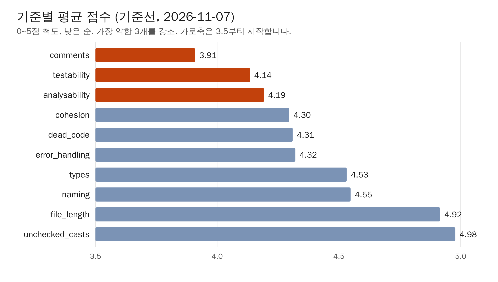

## 평균이 괜찮으면 아무도 안 고칩니다

기준선을 처음 받았을 때 우리가 본 숫자는 파일 루브릭 평균 84.23점이었습니다. 솔직히 급하지 않다고 느꼈습니다. 스타트업에서 AI로 기능을 붙이다 보면 할 일이 늘 밀려 있는데,

그런데 AI로 짠 파일 중에는 너무 긴 것이 있었습니다. 그런 파일을 직접 열어 보니 복잡하게 느껴졌습니다. 숫자는 괜찮다고 하는데 읽는 사람은 괜찮지 않았습니다. 이 어긋남이 줄 수 가중 평균을 함께 보게 된 계기였습니다.

두 루브릭과 10개 기준은 [0편]((0편 URL))에 정리했습니다. 채점에는 평가 엔진 [Verdict](https://github.com/Ustay-coder/verdict)를 썼습니다. 파일 루브릭은 판정 모델(Decision Model) Clef가 파일당 한 번 판정했습니다. 판정 모델 점수는 실행마다 조금 달라질 수 있으므로, 이 글의 소수점 차이는 그 점을 감안하고 읽어 주세요.

평균만 보면 놓치는 것이 있었습니다.

- 측정 대상 2,515개 파일 중 1,249개가 85점 미만이었습니다.
- 중앙값은 85.06점으로 평균 84.23점보다 높았습니다.
- 90점 이상인 A등급 파일은 699개였습니다.

중앙값이 평균보다 높다는 것은 낮은 점수 쪽 꼬리가 평균을 끌어내리고 있다는 뜻으로 읽을 수 있습니다. 이건 우리 해석입니다. 그 꼬리가 어디에 있는지는 기준별 점수와 파일 크기를 같이 보며 찾았습니다.

## 어떤 기준이 왜 약했나

기준 10개의 평균(0~5점)을 낮은 순으로 놓으면 이렇습니다. 가로축은 3.5점부터 시작하므로 막대 길이의 비율을 그대로 비교하지는 마세요.

가장 약한 세 기준은 다음과 같습니다.

- comments 3.91
- testability 4.14
- analysability 4.19

testability와 analysability는 같은 쪽으로 묶어 볼 수 있습니다. 기준선 기록에는 800~1,500줄에 이르는 서비스·repository·스키마가 바로 이 두 기준에서 감점됐다고 남아 있습니다. 0편에서 소개한 다른 두 유형도 같은 모양입니다. API route는 62~69점, 클라이언트 훅은 69.8점 등을 받았고, 둘 다 여러 역할이 한 함수나 한 파일에 섞여 있었습니다. 한곳에 역할이 몰리면 읽기도 어렵고, 떼어 내서 테스트하기도 어렵습니다.

모델과 상관없는 지표도 같은 방향을 가리켰습니다. repo 루브릭에서 60줄을 넘는 함수는 913개였고, unit_size 점수는 0이었습니다. 판정 모델 점수와 독립적으로 잰 값이 같은 쪽을 가리킨다는 정도로만 받아들였습니다. 둘 사이의 인과까지 확인한 것은 아닙니다.

comments는 세 기준 중 가장 낮았지만, 이유는 이번 라운드에서 따로 들여다보지 않았습니다.

여기서 이상한 점이 하나 있습니다. file_length 기준 평균은 4.916으로 높은 편입니다. 400줄을 넘는 파일이 2,515개 중 69개뿐이라, 파일마다 한 표씩 주고 평균을 내면 거의 드러나지 않습니다. 그런데 우리가 살펴본 낮은 점수 파일의 예시는 모두 바로 그 큰 파일들이었습니다. 낮은 점수가 전부 큰 파일에 있었는지는 점수 분포가 없어 확인하지 못했습니다.

## 줄 수 가중 평균을 왜 함께 보나

먼저 정정할 것이 있습니다. 0편 마지막 문장에서 "줄 수에 대해 더 가중치를 왜 더 주었는지 설명합니다"라고 썼는데, 정확한 표현이 아니었습니다. 단순 평균을 버리고 가중 평균으로 바꾼 것이 아니라, 두 값을 나란히 놓고 차이를 봤습니다.

| 지표 | 값 |
|---|---:|
| 파일 루브릭 평균 | 84.23 |
| 중앙값 | 85.06 |
| 줄 수 가중 평균 | 78.77 |
| 차이(평균 − 가중) | 5.46 |

단순 평균은 짧은 파일과 1,500줄짜리 파일을 똑같이 한 표로 셉니다. 하지만 사람이 코드를 읽고 고치는 데 드는 시간은 파일 개수보다 줄 수에 더 가깝습니다. 그래서 "실제로 읽게 되는 코드 기준으로는 몇 점인가"를 보려고 가중 평균을 옆에 두었습니다. 두 값이 5.46점 벌어졌다는 것이 큰 파일일수록 점수가 낮은 경향의 신호였습니다.

낮은 점수 파일 예시입니다. 전체 순위가 아닙니다. 이후 점수가 가장 많이 오른 파일 목록에서 기준선 점수를 가져왔으므로, 고르는 과정에서 큰 파일 쪽으로 치우쳤을 수 있습니다.

| 역할 | 점수 | 줄 수 |
|---|---:|---:|
| 워커 런타임 모듈 | 60.65 | 786 |
| 핵심 도메인 repository | 60.44 | 1,515 |
| 결과 클라이언트 모듈 | 67.16 | 579 |
| 링크 repository | 63.17 | 1,269 |
| 제출 데이터 repository | 62.97 | 877 |
| 집계 캐시 서비스 | 65.65 | 770 |
| 최종 검토 서비스 | 67.16 | 845 |

표의 예시는 모두 400줄을 넘는 파일입니다.

다만 가중 평균은 좋은 지표라서 고른 것이 아닙니다. 단순 평균이 가리는 것을 보려고 옆에 둔 보조 지표입니다. 한계도 분명합니다.

- **분할만으로 오릅니다.** 점수가 낮은 큰 파일을 작은 파일 여럿으로 쪼개기만 해도 가중 평균은 오릅니다. 품질이 그대로여도 숫자가 움직입니다. 기준선은 분할 전이라 이 문제가 없지만, 이후 편에서 이 지표를 근거로 쓸 때는 다른 지표와 함께 봐야 합니다. 첫 주 결과에서 이 점을 짚은 내용은 [0편]((0편 URL))에 있습니다.
- **줄 수는 대리값입니다.** 길어도 단순한 파일과 짧아도 핵심인 파일의 차이는 반영하지 못합니다.
- **집계 수준의 경향입니다.** 파일 점수와 줄 수의 관계를 직접 계산한 값은 없습니다. 그래서 둘의 상관을 수치로 말하지 않습니다.

## 기준선에서 정한 것

이 편은 기준선을 다루므로 전·후 비교표는 없습니다. 대신 기준선을 보고 우선순위를 정했습니다. 큰 파일과 역할이 섞인 파일을 먼저 다루기로 했습니다. 구체적인 작업과 결과는 다음 편부터 다룹니다.

## 남은 문제

- 기준선 전체에서 점수가 가장 낮은 파일의 순위도 이번 글에는 없습니다. 위 예시는 일부일 뿐입니다.
- comments가 가장 약한 이유는 미확인입니다.
- 등급은 A(90점 이상, 699개)와 D(70점 미만, 108개)만 알고 있습니다. B·C 경계와 파일 수, 점수 분포는 미확인입니다.
- 줄 수 가중 평균에서 분할 효과만 따로 떼어 볼 방법이 아직 없습니다. 측정 편에서 다시 다룹니다.
- 판정은 파일당 한 번이었습니다. testability 4.14와 analysability 4.19처럼 기준별 평균이 근소하게 다른 것은 판정 분산 안에 있을 수 있어서, 순위를 크게 해석하지 않습니다.

## 스코어보드

| 지표 | 기준선 | 이번 편 시점 | 변화 |
|---|---:|---:|---:|
| 파일 루브릭 평균 | 84.23 | 84.23 | — |
| 줄 수 가중 평균 | 78.77 | 78.77 | — |
| 400줄 초과 파일 | 69 | 69 | — |
| 커버리지(line) | 60.2% | 60.2% | — |
| repo 루브릭 종합 | 44.1 | 44.1 | — |

이 편은 기준선 시점이라 두 열이 같습니다. 현재 값은 [0편]((0편 URL))의 첫 주 결과 표를 보세요.

## 다음 편 예고

기준선에서 역할이 한곳에 몰린 API route와 클라이언트 훅이 낮은 점수를 받았다는 걸 확인했습니다. 다음 편에서는 루브릭 점수를 보며 이 둘을 나누는 패턴을 작은 범위에서 먼저 시험해 본 파일럿을 다룹니다.
